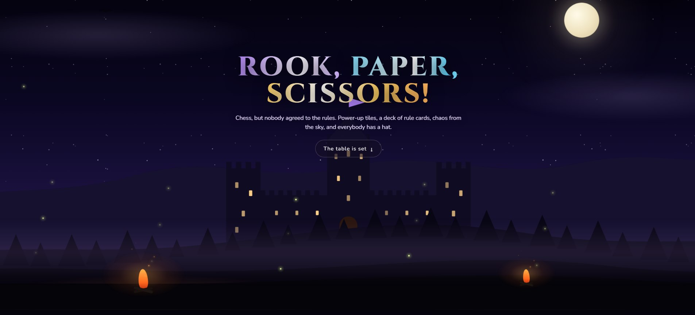
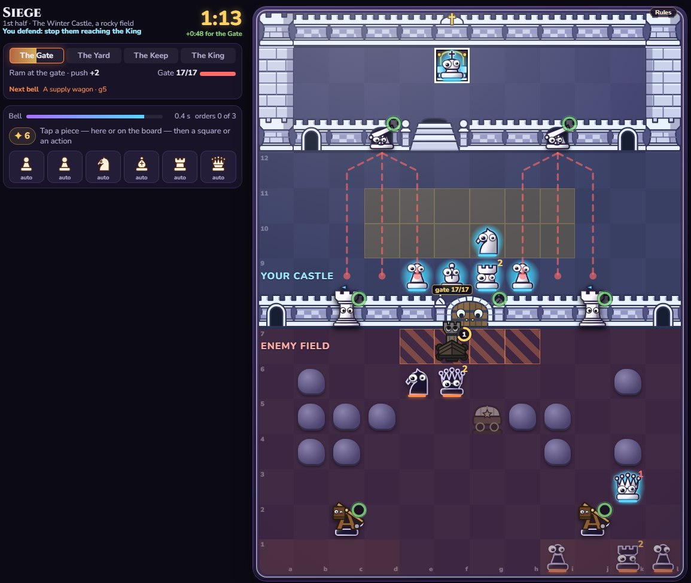
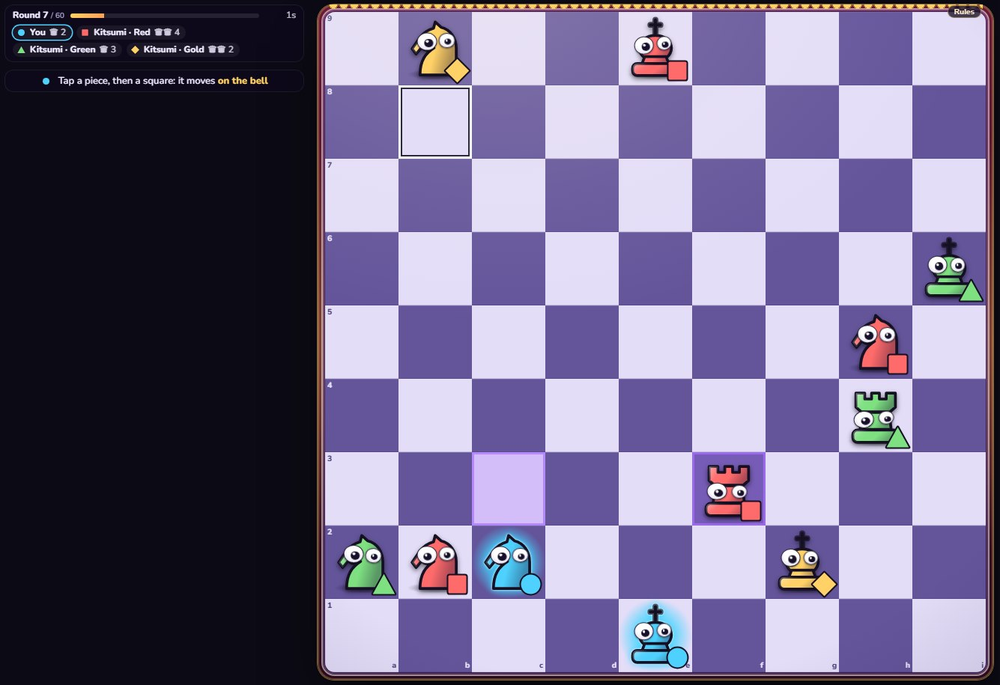
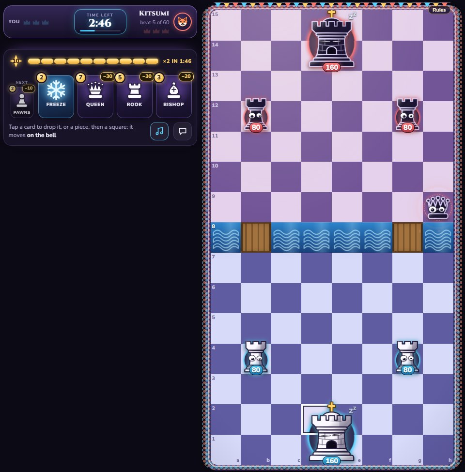
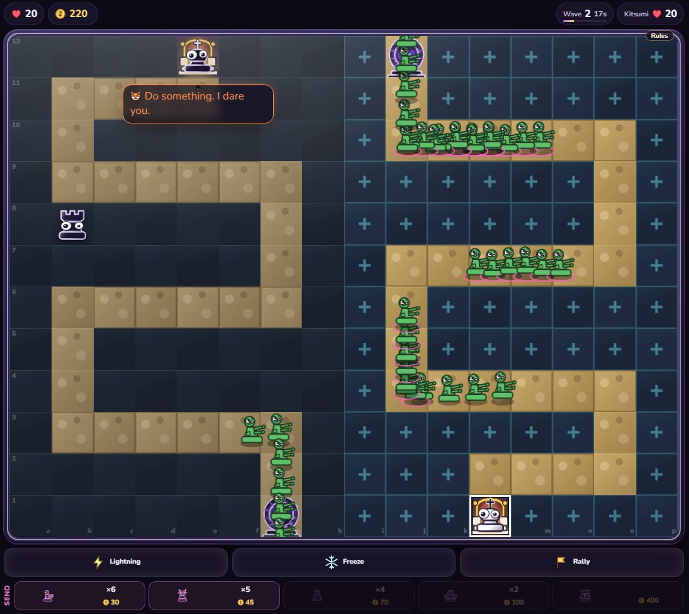

# Rook, Paper, Scissors! 

  <b>Chess, but the board fights back, the rules change mid-game, and your pawn holds a grudge.</b> 
  <a href="https://rookpaperscissors.com"><b>Play it in your browser →</b></a>

  No download. No account needed. No adverts. Your knight has already started without you.

---

You know how chess works. Forget most of it.

Every few moves you draft a rule from a deck of 88 cards, and so does your opponent. Tiles hand out
power-ups. Chaos falls from the sky. Pirates turn up. Aliens turn up. A pawn that survives four games
gets a name and keeps it, and if it wins enough it gets a hat. The hat is worn by that one pawn, who
will be insufferable about it.

Then you take the same pieces and play football with them.

<table>
<tr>
<td width="50%"> <b>Siege.</b> A ram at the gate, trebuchets in the field, and a clock nobody asked for.</td>
<td width="50%"> <b>Last Crown.</b> Four armies, one bell, and a king who should have left earlier.</td>
</tr>
<tr>
<td width="50%"> <b>Crown Clash.</b> Drop pieces from your hand and go after their towers, in real time.</td>
<td width="50%"> <b>Fortress.</b> Your pieces build the defence. The horde has other plans.</td>
</tr>
</table>

## Everything on the table

- **The Book of Squares.** Seven chapters of hand-built battles against regents who each cheat in
  their own way, with hearts, second chances and a story between the boards.
- **An Arcade of fifteen games for the same pieces.** Last Crown, Battle Royale, Siege, Fortress,
  Tumbledown, Rumble Ball, Vault Raid, Secret King and an immortal snail that will not stop coming
  for your king. Yes, really.
- **An army with a memory.** Sixteen units carry their fame, their shame, their kills and their names
  from game to game.
- **Two bots with opinions.** Kitsumi is a fox. Lexi is a lion. Both will talk while they beat you.
- **Actual humans.** Rated games, private rooms behind a code, party rooms and 2v2.
- **Your Twitch chat as your opponent.** Point it at a channel and the viewers vote on every move. No
  extension, no login, no bot in the channel. They will still blame you.
- **Plain chess, if you must.** The chaos is optional and stays out of ranked games. Nobody will
  judge you. Your pawn might.

## Free, and honest about it

The game is free, and almost everything in it is earned by playing. Keys, gold, a few premium hats,
looks and piece sets, Crown Clash cards, the Crown Pass and a second Locksmith are also sold on Ko-fi.
Nothing you can buy is random, and nothing you can buy changes who wins a ranked match.
There are no adverts, no analytics, no
cookies and no tracking of any kind: see the [privacy policy](PRIVACY.md), which is short because
there is very little to say. Signing in is optional and never involves a password. It exists so your
army survives a cleared browser.

## The tiny staff

  
  
  
  
  
  
  
  
  
  

The pieces also moonlight. A pawn, a knight, a living sheet of paper, a pair of scissors and the rest
of the cast hold up your visit count on little wooden signs: the
[Rook, Paper, Scissors! GIF Counter](https://github.com/Olexify/RoOokKingdomGifCounter) is free and
self-hosted, for your GitHub profile or website. They ask only to be looked at.

## Legal

- [Privacy policy](PRIVACY.md) — also at <https://rookpaperscissors.com/privacy.html>
- [Terms of use](TERMS.md) — also at <https://rookpaperscissors.com/terms.html>

## About this repository

This is the public page for the game. **It contains no source code.** Rook, Paper, Scissors! is
not open source.

> Copyright © 2026. All rights reserved. The game and everything in it — code, artwork, sounds,
> text, rules, characters and name — may not be copied, redistributed, modified or reused.

Streaming it, recording it and writing about it are welcome, including on monetised channels.

## Contact

<support@olexify.dev>
